  

    
  

  

    
    
    <!--  -->
  <!--    -->
    
     
    <!--   -->
    
    
    
    <!--  -->
    
  

 

<!-- terminal-profile -->

  

<!-- /terminal-profile -->

  

<!-- <h3 align="center">Artworks</h3> -->
<!-- artworks -->

<!-- <h3 align="center">Toys</h3> -->
<!-- toys -->

<!-- <h3 align="center">Recent Tales</h3> -->
<!-- recent_tales -->

<!-- <h3 align="center">Recent Stars</h3> -->
<!-- recent_stars -->

<!-- <h3 align="center">Random Stars</h3> -->
<!-- random_stars -->

「<strong><samp><strong>幸せに</strong></samp></strong>」

<!-- footer -->
